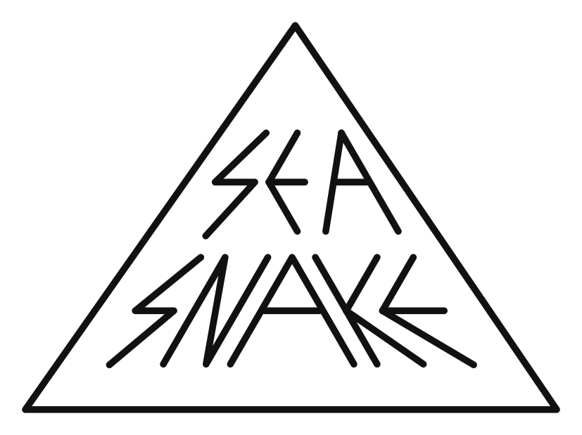
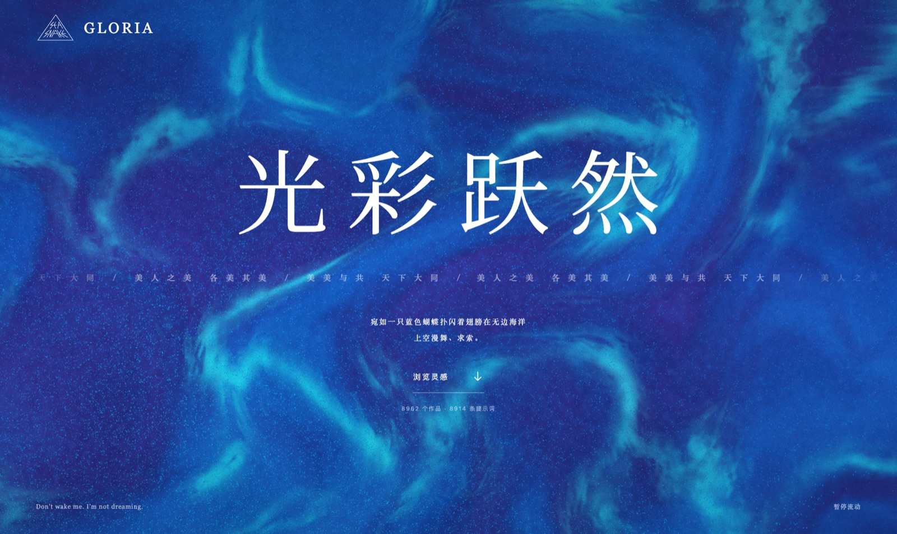
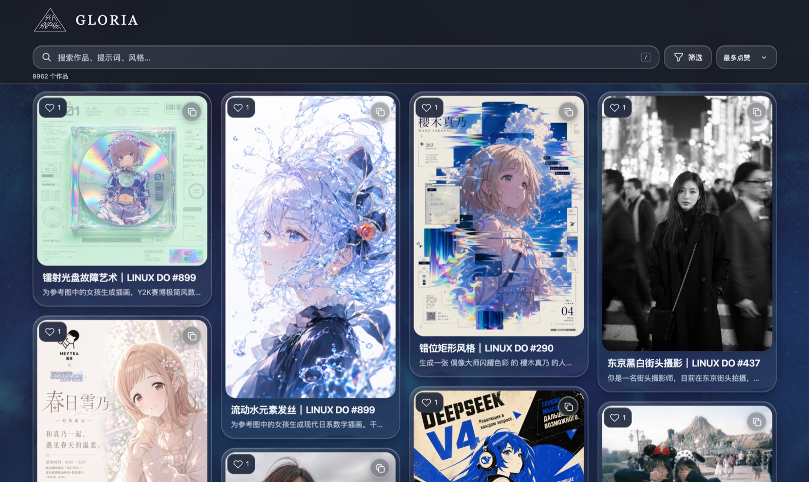
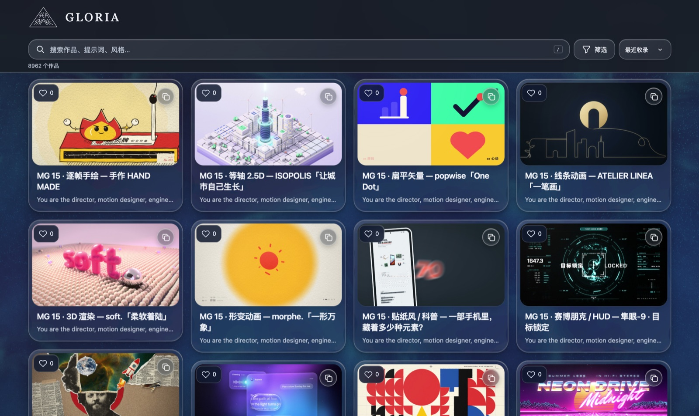

<div align="center">

<a href="https://seasnakes.github.io/gloria-prompt-archive/"></a>

# 光彩跃然 · 影像灵感库

**AI 视频和图像提示词的收藏夹，每一条都写着作者和出处。**<br>
<sub>Seedance、GPT Image、Claude Opus、MiniMax 等 · 网页上能搜，也能交给 coding agent 搜 · <a href="README.md">English</a></sub>

<a href="https://seasnakes.github.io/gloria-prompt-archive/"></a>
<a href="README.md"></a>
<a href="https://seasnakes.github.io/gloria-prompt-archive/"></a>
<a href="https://seasnakes.github.io/gloria-prompt-archive/"></a>
<a href="https://github.com/seasnakes/gloria-prompt-archive/actions/workflows/pages.yml"></a>

<a href="#让-ai-帮你找"></a>
<a href="#只要-mcp"></a>
<a href="https://seasnakes.github.io/gloria-prompt-archive/llms.txt"></a>
<a href="https://github.com/seasnakes/gloria-prompt-archive/actions/workflows/pages.yml"></a>
<a href="https://github.com/seasnakes/gloria-prompt-archive/stargazers"></a>
<a href="https://x.com/snakeseas"></a>
<a href="https://space.bilibili.com/486682682"></a>
<a href="https://www.zhihu.com/people/SeASnAkE"></a>

**新** 2026-10-28 · 不想自己翻，可以让 Claude Code、Codex 替你搜了。[怎么装 ↓](#让-ai-帮你找)

</div>

<a href="https://seasnakes.github.io/gloria-prompt-archive/"></a>

## 这是什么

我在飞书里攒了一个提示词作品库，这个网站是它的公开版。

收的主要是 AI 视频和图像的提示词。Seedance / 即梦最多，然后是 GPT Image、Claude Opus 5.5 写代码做出来的动画、MiniMax H3。大部分是 X 和 LINUX DO 上的公开帖子，很多是顺着 YouMind、Prompt Motion 这些站点和几个开源仓库成批找来的。每一条都留着作者名字和原帖链接，视频和图在网页上能直接看。

<a href="https://seasnakes.github.io/gloria-prompt-archive/"></a>

<sub>这张图和上面的数字跟着网站一起更新。</sub>

收录时守几条规矩：

- 有原始提示词的，收原文。
- 作者没公开提示词的，标「效果参考」，只写效果，不编一段提示词充数。
- 原帖没写模型或生成方式的，标「待确认」，不猜。
- 绝大多数提示词我没有亲手重跑过，标的是「待测试」。效果以原作者的视频为准。

## 在网页上找

<table><tr>
<td width="50%" valign="top"><a href="https://seasnakes.github.io/gloria-prompt-archive/"></a><br><b>最多点赞</b><br><sub>默认的排序，大家点赞最多的在前面。</sub></td>
<td width="50%" valign="top"><a href="https://seasnakes.github.io/gloria-prompt-archive/"></a><br><b>最近收录</b><br><sub>新收进来的在前面。</sub></td>
</tr></table>

[打开灵感库](https://seasnakes.github.io/gloria-prompt-archive/)，往下滑就是画廊。网页有中文和英文两套界面，右上角切换。

- 搜索框会搜标题、提示词全文、作者和标签。提示词大多是英文，中文搜不到就换英文，比如「霓虹」搜不够，再搜 neon。
- 「筛选」里能按模型、生成方式、来源、风格标签组合着找。
- 打开默认按最多点赞排序，右上角能切换成最近收录。点赞不用登录，点卡片左上角的心就行。
- 点开一条可以看视频，左右滑切换。卡片右上角一点就复制提示词。
- 分享某一条，复制作品链接就行，长这样：`…/gloria-prompt-archive/#work/作品ID`。

## 让 AI 帮你找

也可以不打开网页，交给 Claude Code、Codex 这类 agent 去翻。装好以后直接说你要什么：

> 找几个适合咖啡店开业宣传的 Seedance 提示词，要有运镜

> 我想让 Claude 写代码做一段产品发布动画，库里有什么能参考的？

> 随便来五个电影感强的图生视频提示词

可以按题材问（主题、风格、氛围），也可以按任务问（要做产品广告、MV、运镜）。它会中文英文都搜一遍，读完整的提示词，挑四条左右给你，每条带图、完整提示词、原作者和链接。想改成你自己的主题，接着说就行。

### Claude Code

```bash
claude plugin marketplace add seasnakes/gloria-prompt-archive
```

```bash
claude plugin install gloria-prompts@seasnake
```

装的是一个 skill 加一个 MCP 服务，三个工具：`search_prompts` 搜索，`get_prompts` 读全文和图片、视频链接，`list_facets` 列出所有模型、方式和标签。

### Codex、Cursor 和其他 agent

```bash
npx skills add seasnakes/gloria-prompt-archive
```

它会问你装到哪些 agent 里（这个工具要 Node 22.20 以上）。也可以手动把 [`plugin/skills/gloria-prompts/`](plugin/skills/gloria-prompts/) 整个文件夹复制到 `~/.agents/skills/`（Codex）或 `~/.claude/skills/`（Claude Code）。

第一次搜索会下载一份数据，大约 8 MB，之后缓存六小时。Codex 默认的沙盒不联网，第一次搜索要你允许它联网。

### 只要 MCP

脚本只有一个文件，不用装依赖，Node 18 以上就能跑：

```bash
curl -fsSL https://raw.githubusercontent.com/seasnakes/gloria-prompt-archive/main/plugin/skills/gloria-prompts/scripts/gloria.mjs -o ~/gloria.mjs
```

```bash
codex mcp add gloria-prompts -- node ~/gloria.mjs mcp
```

Claude Code 用 `claude mcp add gloria-prompts -- node ~/gloria.mjs mcp`。别的客户端照它们的格式填 `node ~/gloria.mjs mcp` 即可。

同一个脚本也能直接在终端里用：

```bash
node ~/gloria.mjs search 霓虹 雨夜 --model seedance
```

`node ~/gloria.mjs --help` 看全部参数。

### 什么都不装

网站给 agent 备了纯文本版本，能上网的 agent 直接读就行：

| 地址 | 内容 |
|---|---|
| [`llms.txt`](https://seasnakes.github.io/gloria-prompt-archive/llms.txt) | 怎么用，以及所有筛选项 |
| [`agent/prompts.json`](https://seasnakes.github.io/gloria-prompt-archive/agent/prompts.json) | 全部提示词，一行一条，能直接 `grep` |
| `agent/works/作品ID.md` | 单条作品，带图。把作品链接里的 `#work/` 换成 `agent/works/`，末尾加 `.md` |
| `agent/media/作品ID.json` | 单条作品当前的图片和视频链接 |
| [`agent/facets.json`](https://seasnakes.github.io/gloria-prompt-archive/agent/facets.json) | 每个模型、方式、标签各有多少条 |

这些文件和网站同一次构建生成，内容一致。图片和视频用的是飞书临时链接，每次同步后大约一天过期，所以 `prompts.json` 里不放，单条作品的文件里放当前有效的。作品的网页链接一直有效。

## 数据从哪来

内容在飞书多维表格里维护。GitHub Actions 每六小时读一遍整张表，重新构建网站，所以新收的作品最晚几个小时后出现。

飞书凭据、同步脚本、点赞服务、只改界面时怎么发布、怎么回退，都写在 [docs/MAINTAINING.md](docs/MAINTAINING.md)。

## 本地跑起来

需要 Node.js 22。

```bash
npm ci
```

```bash
npm run dev
```

打开 http://127.0.0.1:5182/ 。仓库里带的是 46 条的小样本，完整数据只在线上。`npm test` 跑测试，`npm run build` 构建，`npm run preview` 在 5183 端口看构建结果。

## 更新记录

- **2026-10-29** · 画廊默认按最多点赞排序。作品详情里点「复制提示词」，「已复制」的提示现在显示在弹窗上面，不再被挡住。
- **2026-10-29** · 加了英文界面，右上角中/EN 切换。首页打字机打出完整的那首小诗，蓝色背景就是从它来的。Logo 改为链接到 X。加了回到顶部按钮。agent 现在一次挑四条左右，每条带图和完整提示词。
- **2026-10-28** · agent 能直接搜库：skill、MCP、`llms.txt` 和单条 Markdown。README 重写，英文版放在首页，中文版是这一份。
- **2026-10-23** · 收进 [Vincentwei1021/mg-styles-15](https://github.com/Vincentwei1021/mg-styles-15) 的 15 种 MG 动画风格，提示词、示例视频、封面都有，[MIT 许可](public/licenses/mg-styles-15-MIT.txt)。
- **2026-10-11** · 加了匿名点赞和「最多点赞」排序。
- **2026-10-08** · 从 Prompt Motion 和 YouMind 收进 481 条 Claude Opus 5.5 的作品。
- **2026-09-19** · 补齐 Seedance 案例的视频和封面。[整理清单](reports/2026-09-19-seedance-import/README.md)

每次导入的核对细节在 [docs/MAINTAINING.md](docs/MAINTAINING.md#历次导入)。

## 版权

- 收录的提示词、视频和图片都归原作者。转用时请署上作者，带上原帖链接。
- 这里只做整理和索引，不保证照着提示词能做出同样的效果。
- 「光彩跃然」页面的概念来自我的 [CodePen 作品](https://codepen.io/seasnakes/pen/oNJgPeP)。三角字标是 SEASNAKE 的品牌资产，不随仓库授权。
- 用到的第三方代码和字体：Three.js（[许可](THREE-LICENSE.txt)）、Typed.js（[许可](TYPED-LICENSE.txt)）、Noto Serif SC 子集（[许可](NOTO-SERIF-LICENSE.txt)）。

## Star History

<a href="https://www.star-history.com/#seasnakes/gloria-prompt-archive&Date">
 <picture>
   <source media="(prefers-color-scheme: dark)" srcset="https://api.star-history.com/svg?repos=seasnakes/gloria-prompt-archive&type=Date&theme=dark" />
   <source media="(prefers-color-scheme: light)" srcset="https://api.star-history.com/svg?repos=seasnakes/gloria-prompt-archive&type=Date" />
   
 </picture>
</a>

<div align="center">
<br>
<sub>美人之美，各美其美。美美与共，天下大同。</sub><br>
<sub>by SEASNAKE · <a href="https://x.com/snakeseas">X</a> · <a href="https://space.bilibili.com/486682682">B站</a> · <a href="https://www.zhihu.com/people/SeASnAkE">知乎</a></sub>
</div>
